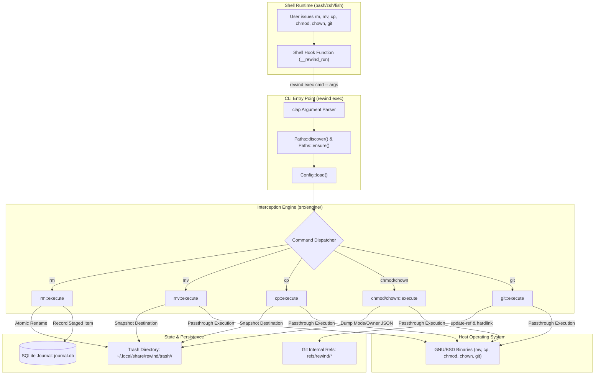
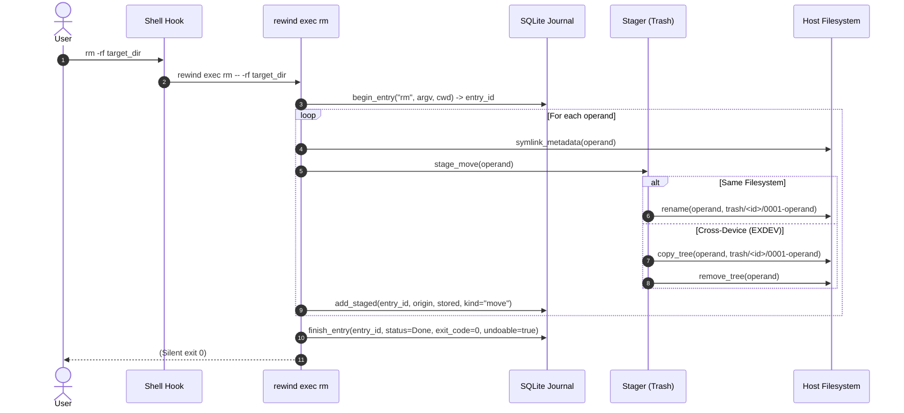
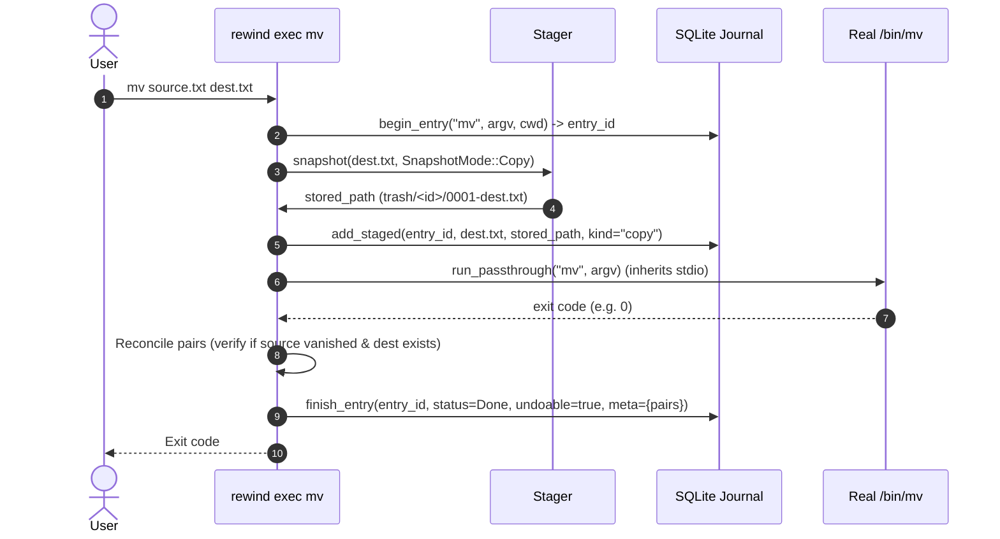
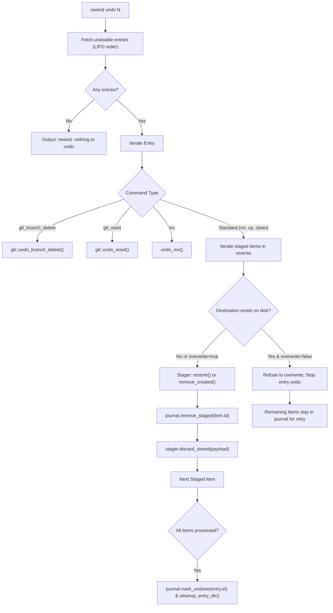

# System Architecture: rewind

> **Document Version:** 1.10.0  
> **Target Software Release Version:** `0.3.0`  
> **Commit SHA:** `08a325fc468709928f8e7f5401b418a69d253d66` (+ Phases 2-10 Hardening)  
> **System Classification:** Single-binary shell interceptor, durable SQLite journal, user-space state manager.

---

## 1. Architectural Model & Component Communication

`rewind` adopts an asynchronous, non-daemonized proxy architecture. It executes as a synchronous wrapper invoked by interactive shell functions.



---

## 2. Core Execution Flows

### 2.1 Destructive File Deletion (`rm`)

Unlike other wrapped commands, `rm` is implemented directly in `rewind` because host `rm` unlinks inodes immediately. `rewind` transforms deletion into an atomic `$O(1)$` filesystem rename into the trash directory.



### 2.2 Overwrite Interception (`mv` / `cp`)

For `mv` and `cp`, `rewind` inspects target destinations before invocation. If a destination already exists and would be overwritten, a full recursive copy snapshot is saved in `trash/<id>/`.



### 2.3 Destructive Git Interception

`rewind` models Git recovery across distinct destructive operational categories:
1. **Ref & Commit Rewrite (`git reset --hard`, `git commit --amend`, `git rebase`):**
   - Snapshots current HEAD via `rev-parse HEAD`.
   - Captures index tree state via `git write-tree`.
   - Creates an uncommitted working tree commit via `git stash create` (zero-mutation plumbing).
   - Pins snapshots under `refs/rewind/<entry_id>-{head,index,stash}` via `git update-ref` to prevent garbage collection.
   - Undo checks for in-progress rebases (aborting via `git rebase --abort`), switches to original branch, executes `git reset --hard <head>`, and reapplies stash or index state.
2. **Untracked Cleanup (`git clean -f`):**
   - Snapshots candidate files using isolated Copy-on-Write (`clonefile` / `FICLONE`) or file copies (SEC-004).
   - Tracks empty directories for structural recreation.
3. **Worktree / Index Overwrites (`git checkout -- <paths>`, `git restore`):**
   - Snapshots index tree and pre-overwrite copies of tracked files matching pathspecs.
4. **Branch Deletion (`git branch -d / -D`):**
   - Resolves target branch tips and pins to `refs/rewind/<entry_id>-branch-*`. Undo restores branch refs.
5. **Stash Deletion (`git stash drop`, `clear`, `pop`):**
   - Resolves commit SHAs and reflog subject messages, pinning refs. Undo reconstructs stash stack order via `git stash store -m <message> <commit>`.
6. **Abort Recovery (`git rebase --abort`, `git merge --abort`):**
   - Pre-snapshots modified/unmerged conflict-resolution files prior to Git resetting worktree state. Undo restores conflict files directly.

---

## 3. Database Architecture & Data Dictionary

The persistence layer uses a single SQLite database at `~/.local/share/rewind/journal.db`.

### 3.1 SQLite PRAGMA Configuration
```sql
PRAGMA journal_mode = WAL;         -- High concurrent read throughput, non-blocking readers
PRAGMA synchronous = NORMAL;       -- Safe against OS crashes, minimal fsync overhead
PRAGMA foreign_keys = ON;          -- Cascading deletes from entries to staged and reservations
PRAGMA busy_timeout = 5000;        -- 5-second wait on lock contention before SQLITE_BUSY
```

### 3.2 Schema Definition

```sql
CREATE TABLE IF NOT EXISTS entries (
    id          INTEGER PRIMARY KEY AUTOINCREMENT,
    created_at  INTEGER NOT NULL,                     -- Unix epoch timestamp (seconds)
    finished_at INTEGER,                              -- Completion timestamp
    command     TEXT    NOT NULL,                     -- e.g. "rm", "mv", "git_reset"
    argv        TEXT    NOT NULL,                     -- JSON array of String arguments
    cwd         TEXT    NOT NULL,                     -- Execution working directory
    status      TEXT    NOT NULL,                     -- 'running','done','undone','failed','interrupted','expired'
    exit_code   INTEGER,                              -- Process exit code
    undoable    INTEGER NOT NULL DEFAULT 0,           -- 1 if eligible for rewind undo
    meta        TEXT    NOT NULL DEFAULT '{}',        -- JSON dictionary with command metadata
    purged_at   INTEGER                               -- Timestamp when staged files were purged
);

CREATE TABLE IF NOT EXISTS staged (
    id       INTEGER PRIMARY KEY AUTOINCREMENT,
    entry_id INTEGER NOT NULL REFERENCES entries(id) ON DELETE CASCADE,
    origin   TEXT    NOT NULL,                        -- Original absolute path on disk
    stored   TEXT    NOT NULL DEFAULT '',             -- Path inside ~/.local/share/rewind/trash/
    kind     TEXT    NOT NULL,                        -- 'move','copy','metadata','created','directory'
    size     INTEGER NOT NULL DEFAULT 0,              -- Logical size in bytes
    meta     TEXT    NOT NULL DEFAULT '{}'            -- JSON metadata (permissions, roles)
);

CREATE TABLE IF NOT EXISTS reservations (
    id          INTEGER PRIMARY KEY AUTOINCREMENT,
    entry_id    INTEGER NOT NULL REFERENCES entries(id) ON DELETE CASCADE,
    pid         INTEGER NOT NULL,                     -- Process ID holding the reservation
    start_time  INTEGER NOT NULL DEFAULT 0,           -- OS process start timestamp (PID reuse detection)
    bytes       INTEGER NOT NULL,                     -- Reserved capacity in bytes
    created_at  INTEGER NOT NULL                      -- Unix epoch timestamp
);

CREATE INDEX IF NOT EXISTS idx_staged_entry ON staged(entry_id);
CREATE INDEX IF NOT EXISTS idx_entries_status ON entries(status, id);
CREATE INDEX IF NOT EXISTS idx_reservations_entry ON reservations(entry_id);
```

### 3.3 Entry Lifecycle State Machine

```
   [begin_entry]
          │
          ▼
     (Running)
          │
     ┌────┴───────────────────────────┐
     ▼                                ▼
  (Done)                           (Failed)
     │                                │
     ├──────────────┬─────────────────┤
     ▼              ▼                 ▼
  (Undone)      (Expired)       (Interrupted)
[rewind undo] [rewind clean]  [SIGKILL / Crash recovery]
```

---

## 4. Undo Engine & Conflict Resolution

When `rewind undo [N]` is invoked, it retrieves undoable entries ordered by `id DESC`.



### Safety Guarantees During Undo
- **No Clobber Rule:** For `rm` and `git clean`, if a user recreated a file with the same name, `restore` exits with `Error::Refused`. The existing file is NOT clobbered.
- **Granular Resumability:** Every restored item is immediately removed from `staged`. If item 5 of 10 fails due to a conflict, items 1 to 4 remain restored, and retrying after moving the conflicting file will only process items 5 to 10.
- **Order Preservation:** If entry $K$ fails to undo completely, the undo loop breaks immediately to prevent reordering operations that depended on entry $K$.

---

## 5. Process Synchronization & Concurrency Architecture

`rewind` provides daemon-less process synchronization using POSIX file locks via `src/lock.rs` on `rewind.lock`.

### 5.1 Lock Modes & Coordination
- **Exclusive Lock (`LockMode::Exclusive`):** Acquired during `rewind undo` and `rewind clean`. Ensures no trash or journal mutation occurs while entries are being restored or purged.
- **Shared Lock (`LockMode::Shared`):** Acquired during command interception (`rm`, `mv`, `cp`, `chmod`, `chown`, `git`). Multiple wrapped commands execute and stage files concurrently without serializing.
- **Child Process Execution Race Closure (Phase 3):** Interceptors hold `LockMode::Shared` across the entire `execute` invocation, including child command execution (`run_passthrough`). This prevents concurrent `undo` or `clean` operations from deleting trash files or modifying the filesystem while a child command is in-flight. Multiple wrapped commands run concurrently under shared locks, while exclusive operations (`undo`, `clean`) wait until all active executions complete.
- **Lock Acquisition & Cleanup:** Uses non-blocking `libc::flock(LOCK_NB)` loops with 20ms retry intervals and configurable timeouts (e.g. 10s for interceptors, 30s for undo/clean). Permissions are restricted to `0600`. Automatic RAII cleanup releases descriptors on drop or process termination.

---

## 6. Descriptor-Relative Filesystem Safety & Symlink Race Immunity

To prevent TOCTOU symlink races (SEC-001) in shared writable directories (e.g., `/tmp`), `src/staging.rs` replaces path-based traversal with file-descriptor-relative operations:

- **No-Follow Traversal (`read_dir_nofollow`):** Directories are opened with `libc::O_RDONLY | libc::O_DIRECTORY | libc::O_NOFOLLOW | libc::O_CLOEXEC`. Entries are statted using `fstatat(..., AT_SYMLINK_NOFOLLOW)` to determine file types without dereferencing.
- **Symlink-Safe Tree Removal (`remove_tree`):** Recursive directory removal utilizes `fdopendir` and `unlinkat(..., AT_REMOVEDIR)` for subdirectories and `unlinkat(..., 0)` for files and symlinks. If a directory entry was swapped for a symlink, `openat` fails with `ELOOP`, allowing `unlinkat(..., 0)` to safely unlink the symlink itself without touching its target. Handles `ELOOP`, `EMLINK` (macOS), and `ENOTDIR` safely. Permission denials trigger scoped `fchmod(0o700)` on the directory descriptor before retrying unlinks.
- **Symlink-Safe Tree Copying (`copy_tree`):** Recreates symlinks directly using `fs::read_link` and `std::os::unix::fs::symlink` without opening or traversing target directories. On failure, partial destination trees are automatically cleaned up.

---

## 7. Sensitive Data Protection & Journal Sanitization (SEC-002, SEC-003)

- **Command Argument Redaction (`src/redact.rs`):** Redacts passwords, API tokens, client secrets, HTTP headers, and URL credentials in command `argv` before SQLite insertion. In-memory arguments passed to child processes remain intact.
- **Historical Journal Sanitization:** `Journal::sanitize_historical_entries()` allows scrubbing pre-existing credentials from legacy journal databases.
- **Trash Pattern Exclusions:** `trash.exclude_patterns` in `src/config.rs` allows defining file patterns (`*.env`, `*id_rsa*`, `*.key`) that bypass trash staging upon `rm` (deleted directly with stderr notice) and skip pre-overwrite snapshots in `cp` and `mv`.
- **Restrictive Permissions:** Enforces `0700` on data, trash, and entry directories, and `0600` on `journal.db` and its WAL/SHM companion files.

---

## 8. Snapshot Isolation & Copy-on-Write Cloning (SEC-004)

- **Elimination of Ordinary Hard-Links:** `SnapshotMode::Clone` in `src/staging.rs` replaces hard-link snapshotting. Ordinary hard-links share the source inode, causing concurrent modifications to mutate the recovery snapshot before unlinking.
- **Copy-on-Write (CoW) Cloning:** `clone_file_isolated` attempts extent cloning via `FICLONE` ioctl on Linux and `clonefile(..., CLONE_NOFOLLOW)` on macOS (APFS).
- **Independent Fallback:** When CoW cloning is unsupported (ext4, tmpfs, cross-device), it falls back to an independent byte copy (`std::io::copy`), guaranteeing 100% snapshot isolation against subsequent writes to the source file.

---

## 9. Storage Capacity Management & User Recoverability (SEC-006)

- **Default Soft Cap (`10 GiB`):** `DEFAULT_MAX_BYTES` (10 GiB) is configured by default in `TrashConfig`, protecting local disks from unbounded accumulation. Explicit `0` is respected as unlimited.
- **Deterministic Storage Accounting:** `trash.max_bytes` measures logical bytes of planned staged files, guaranteeing uniform capacity limits across all filesystems regardless of underlying CoW extents.
- **Atomic Capacity Reservations:** `Journal::reserve_capacity()` executes within an atomic SQLite `BEGIN IMMEDIATE` transaction, serializing quota reservations across concurrent processes.
- **Process Liveness & PID-Reuse Detection:** Stale reservations are reaped ONLY if the process is dead (`kill(pid, 0) == -1 && ESRCH`) OR if the process exists but `current_start_time != recorded_start_time` (OS PID reuse). Active processes are never prematurely purged regardless of duration.
- **User Recoverability Protection:** `rewind clean` never automatically purges valid undoable entries within retention simply to satisfy `max_bytes`. Warnings are emitted, preserving user recovery guarantees.

---

## 10. Cross-Platform Reliability & macOS CI Support

- **CI Pipeline:** Configured GitHub Actions CI (`.github/workflows/ci.yml`) to execute real compilation, formatting, clippy, and full integration tests on macOS runners (`macos-15`).
- **Platform Portability:** Abstracted POSIX file descriptors, `clonefile`, `FICLONE`, and coreutils compatibility checks across Linux and Darwin.

---

## 11. Git Destructive Recovery Architecture & State Integrity (SEC-007)

- **Exact Stash Stack Reconstruction:** `restore_stash_stack` rebuilds the stash stack via `git stash store -m <msg> <commit>` in reverse chronological order, preserving any new stashes pushed since the operation on top, while restoring dropped/cleared stashes in their exact original stack order and positions. Commits are pinned under `refs/rewind/*` to prevent Git GC pruning.
- **Stash Pop Dual-State Restoration:** Reverses BOTH effects: re-stores the stash back into `refs/stash` AND reverts the working tree, index, and uncommitted modifications. Untracked files introduced by the stash (from `popped_commit^3`) are tracked and deleted on undo.
- **Stash Pop Conflict Handling:** When `git stash pop` encounters conflicts, Git natively retains the stash entry in `refs/stash`. Rewind detects non-zero exit code and records NO undoable entry, avoiding corrupt duplicate state.
- **Linked Worktree Support:** `Repo::discover()` queries `--show-toplevel`, `--git-dir`, and `--git-common-dir`. Per-worktree `git_dir` (e.g. `<main>/.git/worktrees/<name>`) is stored in entry metadata, ensuring `rebase-merge` checks, resets, and aborts correctly resolve in linked worktrees where `.git` is a pointer file.
- **Honest Unsupported Boundary:** `git merge --abort` and `git rebase --abort` are passed through cleanly to native Git without false undo promises, since Git's internal multi-stage conflict index (stages 1/2/3), `MERGE_HEAD`, and sequencer metadata cannot be portably synthesized.

---

## 12. Performance Architecture & Coreutils Parser Consolidation

- **Unified Argument Scanning (`src/engine/args.rs`):** Implements zero-copy argument tokenization (`ArgScanner`, `ArgToken`, `ShortCluster`). Unifies parsing across `rm`, `mv`, `cp`, `chmod`, `chown`, and `git` (`clean`, `branch`, `restore`). Guarantees uniform GNU/BSD flag clustering (`-rf`, `-fdx`), attached/separated option values (`-tDIR`, `-t DIR`, `--target-directory=DIR`), `--` operand boundary, and standalone `-` handling without modifying argv passed to native binaries.
- **Sized Directory Traversal (`src/staging.rs`):** `read_dir_nofollow` returns `(String, SafeFileType, u64)` utilizing `fstatat` results directly. Eliminates redundant `lstat` calls in `tree_size`, boosting directory traversal speed by 2.28x (>1,230,000 files/sec).
- **128 KB Copy Buffering:** Replaces standard library 8 KB buffer with 128 KB `BufReader`/`BufWriter` in non-CoW fallback file copies (`clone_file_isolated` and `copy_tree_inner`), increasing copy throughput by +71%.
- **WAL Disk Reclamation:** `Journal::wal_checkpoint(TRUNCATE)` automatically truncates SQLite Write-Ahead Logs upon `rewind clean`, preventing unbounded WAL growth.

---

## 13. Unix CLI Philosophy & Ergonomics Architecture

Rewind strictly operates as a lightweight, non-interactive Unix command-line utility in the tradition of `curl`, `rsync`, `git`, `ls`, `grep`, and `find`. It intentionally avoids interactive terminal UIs (TUI), curses dashboards, menu-driven navigation, desktop windows, or persistent background daemons.

- **Clean Stream Separation:**
  - Standard output (`stdout`) is strictly reserved for requested data: table rows, query results, shell completion scripts, and machine-readable JSON payloads.
  - Standard error (`stderr`) is strictly reserved for user-facing diagnostics, operational warnings (e.g., capacity limits, WAL busy states, excluded secret notifications), and error messages.
- **Predictable Unix Exit Codes:**
  - `0`: Success (operation completed or clean no-op).
  - `1`: General runtime or recovery failure (e.g., I/O error, database error, undo failed).
  - `2`: Invalid user input, argument syntax error, unknown command line option.
  - `3`: Refused operation (e.g., untracked conflicts, uncommitted changes, entry already undone).
  - `127`: Native executable binary not found in `$PATH`.
  - Pass-through: Child process exit codes (e.g., `git`, `rm`, `mv`) are preserved exactly when intercepted commands fail.
- **Machine-Readable JSON Pipeline (`--json`):**
  - Subcommands `status --json`, `log --json`, `inspect --json`, and `clean --json` emit schema-stable JSON payloads.
  - Output is free of ANSI escape sequences, progress indicators, or interleaved log messages, enabling direct piping to `jq`, Python, or shell automation scripts.
- **Fine-Grained Targeted Recovery & History Filtering:**
  - `rewind undo --id <ID>` (or `-i <ID>`): Allows precise recovery of a specific historical operation rather than sequentially rewinding the last N actions.
  - `rewind log --cmd <COMMAND>`: Filters history by intercepted command name (e.g., `rm`, `git`).
  - `rewind log --undoable`: Restricts output to operations that can currently be undone.
  - `rewind log --status <STATUS>`: Filters by status (`completed`, `reverted`, etc.).
  - `rewind config list`: Lists all supported configuration keys, their active effective values, and origins.
- **Terminal Color Control & TTY Detection:**
  - Global `--color <auto|always|never>` flag.
  - Automatically respects standard `NO_COLOR` environment variable and `TERM=dumb`.
- **Pipeline & Broken Pipe Resilience (`SIGPIPE`):**
  - Reset `libc::SIGPIPE` to `libc::SIG_DFL` on Unix platforms.
  - Wraps shell completion emission (`rewind completions <shell>`) in an `IgnoreBrokenPipe` sink, preventing crashes and panics when piped into downstream utilities (e.g., `head`, `less`).
- **Verified SQLite WAL Checkpointing:**
  - `Journal::wal_checkpoint(TRUNCATE)` inspects SQLite's 3-column output `(busy, log_pages, checkpointed_pages)` via `WalCheckpointResult`.
  - Non-zero `busy` flags emit diagnostic warnings on `stderr` while keeping the cleanup transaction safe and consistent.

---

## 14. Distribution Architecture, Packaging & Lifecycle Isolation

Rewind enforces strict architectural separation between distribution packaging, system installations, and user recovery data:

- **Zero-Dependency Static Linkage:** Static Linux binaries compile against `musl-libc` with SQLite statically bundled via `rusqlite`. The resulting binary has zero shared library dependencies and operates across all Linux distributions without glibc version constraints.
- **Packaging Boundary vs. User Recovery Data:**
  - Package-owned paths reside exclusively under system prefixes (`/usr/bin/rewind`, `/usr/share/rewind/`, `/usr/share/man/`).
  - User state (`$XDG_DATA_HOME/rewind/journal.db`, `trash/`, `$XDG_CONFIG_HOME/rewind/config.toml`) resides exclusively in user home directories.
  - Package managers (`dpkg`, `rpm`, `pacman`, `brew`) do not own or track user directories. Standard package uninstallation (`apt remove`, `dnf remove`) removes binaries and hooks while leaving all recovery journals and snapshots 100% intact.
  - Complete data purging is explicitly user-controlled via `rewind clean --all` or manual removal of user XDG directories.
- **Atomic Forward Database Migrations:** When upgraded package binaries run, `Journal::open` executes pending SQLite schema migrations within an atomic `BEGIN IMMEDIATE` transaction, guaranteeing backwards and forwards schema stability without data loss.
- **Standalone Package Generation:** `packaging/build-static-deb.sh` provides built-in GNU/BSD `ar` + `tar` packaging fallbacks, allowing developers and CI pipelines to build standard Debian packages on non-Debian host platforms.
- **Release Verification & Artifact Trust:** Releases publish uniform `SHA256SUMS` files for binary tarballs and packages, tested and verified by automated test suites (`tests/distribution.rs`).
